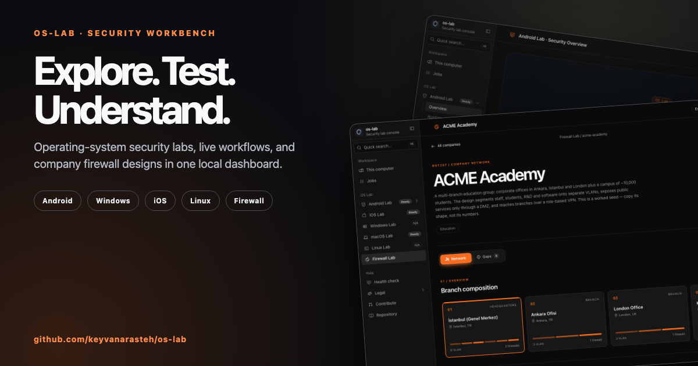

<div align="center">

# os-lab

<a href="https://keyvanarasteh.github.io/os-lab/">
  
</a>

### [keyvanarasteh.github.io/os-lab](https://keyvanarasteh.github.io/os-lab/)

[Code signing policy](CODE_SIGNING.md) · [Desktop releases](https://github.com/keyvanarasteh/os-lab/releases?q=app-v)

Runnable security labs, disk cleanup, and a guarded MCP server in one repository —
isolated guests driven by `make` and `labctl`, plus installable plugins for Claude, Codex, Cursor, ZCode and Grok.

[](https://github.com/keyvanarasteh/os-lab/releases/latest)
[](CONTRIBUTING.md)
[](LICENSE)

</div>

## Download

| Platform | Installer | Also available |
|:--|:--|:--|
| **macOS** — Apple Silicon & Intel | [`os-lab_0.4.12_macos_universal.dmg`](https://github.com/keyvanarasteh/os-lab/releases/download/app-v0.4.12/os-lab_0.4.12_macos_universal.dmg) | [`.app.tar.gz`](https://github.com/keyvanarasteh/os-lab/releases/download/app-v0.4.12/os-lab_0.4.12_macos_universal.app.tar.gz) |
| **Windows x64** | [`os-lab_0.4.12_windows_x64-setup.exe`](https://github.com/keyvanarasteh/os-lab/releases/download/app-v0.4.12/os-lab_0.4.12_windows_x64-setup.exe) | [`.msi`](https://github.com/keyvanarasteh/os-lab/releases/download/app-v0.4.12/os-lab_0.4.12_windows_x64.msi) |
| **Linux amd64** | [`os-lab_0.4.12_linux_amd64.deb`](https://github.com/keyvanarasteh/os-lab/releases/download/app-v0.4.12/os-lab_0.4.12_linux_amd64.deb) | [`.rpm`](https://github.com/keyvanarasteh/os-lab/releases/download/app-v0.4.12/os-lab_0.4.12_linux_amd64.rpm) · [`.AppImage`](https://github.com/keyvanarasteh/os-lab/releases/download/app-v0.4.12/os-lab_0.4.12_linux_amd64.AppImage) |

<sub>Latest **0.4.12** · [all files, checksums & signatures](https://github.com/keyvanarasteh/os-lab/releases/tag/app-v0.4.12) · [install & uninstall](app/INSTALL.md) · [GitHub Releases](https://github.com/keyvanarasteh/os-lab/releases?q=app-v) · older notes in [docs/RELEASES.md](docs/RELEASES.md). Every asset has a `.sha256` and detached `.sig`; in-app updates use the signed feed published by the `updater-manifest` workflow. Signed [content packs](docs/CONTENT.md) can update Firewall companies and guides without a new app build.</sub>

Windows installers have verified updater signatures but no Authenticode signature;
SmartScreen may warn (**More info → Run anyway**). Every release build is attested:
verify a download with `gh attestation verify <file> -R keyvanarasteh/os-lab`.
See [Windows signing](app/SIGNING.md).

## Labs

| Lab | What you get |
|:--|:--|
| [**Windows**](win-lab/) | Windows VM in Docker (`dockur/windows`) — web desktop, RDP, shared folder, backup and reset; WinApps UI Automation on Windows hosts |
| [**Android**](android-lab/) | Emulator + MobSF, mitmproxy, Frida and containerized RE tools; static and dynamic workflows |
| [**iOS / macOS**](ios-lab/) | macOS VM on Ubuntu, or native Xcode / Simulator / Appium on macOS; macOS Lab mirror and computer-use actions on the host |
| [**Linux**](linux-lab/) | Disposable KVM guest for malware detonation, ELF RE, exploit/kernel and container-escape practice |
| [**Cleanup**](cleanup-lab/) | Host disk scan → plan → confirmed clean, volumes, cache relocation, leftovers and desktop widgets |
| [**Source Lab**](source-lab/) | Portable Python source/package analysis, signed evidence, structural maps and local dashboard workflows; native/live verification remains open as bonus contributions |
| [**Firewall**](firewall-lab/) | Student-built company network and firewall designs, rendered at [`/firewall/`](https://keyvanarasteh.github.io/os-lab/firewall/) |
| [**Web**](web-lab/) | Embedded in-app browser (Rust/wry) with JavaScript injection — before page scripts and on demand — and a captured page-activity event log |
| [**Web Sec**](web-sec/) | Scope-guarded web posture assessment: DNS, TLS, headers, cookies and exposure with JSON/SARIF/Markdown reports; standard library only |

## Agents (MCP and plugins)

The local console exposes a guarded **MCP server** (`console/mcp_server.py`) with lab tools, HTML widgets, MCP apps, skills and a [verification registry](console/mcp_verification.json). Public guides: [`/mcp/`](https://keyvanarasteh.github.io/os-lab/mcp/).

Installable host plugins live under [`plugins/`](plugins/): **Claude** (Code + Desktop), **Codex**, **Cursor**, **ZCode** and **Grok Build** — each with describe / check / previewed install and doctor skills.

## Quick start

```bash
# Linux
curl -fsSL https://raw.githubusercontent.com/keyvanarasteh/os-lab/master/scripts/setup/install.sh | bash
# macOS
curl -fsSL https://raw.githubusercontent.com/keyvanarasteh/os-lab/master/scripts/setup/install-macos.sh | bash
# Windows (PowerShell)
irm https://raw.githubusercontent.com/keyvanarasteh/os-lab/master/scripts/setup/install.ps1 | iex
```

Add `--report-only` (`-ReportOnly` on Windows) to inspect the host without changing anything. Then:

```bash
./labctl ui            # web console → http://127.0.0.1:5050
./labctl all status    # android + win + linux at a glance
./labctl ios start     # Ubuntu macOS-VM path
./labctl cleanup status
```

The console shows what this computer can run, what each lab still needs, per-lab install/start/stop/preview actions, jobs, Cleanup, MCP setup and the Android workbench. It and the desktop app are available in **English, Turkish, German, French, Spanish, Italian, Persian and Arabic** (right-to-left for Persian and Arabic).

> **Authorized use only.** Test only systems and apps you own or have written permission to assess; use valid Windows and macOS licences. See [SECURITY.md](SECURITY.md), the [Terms of Use](docs/legal/TERMS.md) and the [Acceptable Use Policy](docs/legal/ACCEPTABLE_USE.md).

<details>
<summary><b>Repo map, runtime map and deeper docs</b></summary>

| Path | What it is |
|:--|:--|
| [`labctl`](labctl) | Management CLI — profiles, lifecycle, resize, monitoring, service units |
| [`dashboard/`](dashboard/) | Web console and the public Pages site |
| [`app/`](app/) | Desktop client (Tauri) with signed in-app updates |
| [`cleanup-lab/`](cleanup-lab/) | Disk cleanup engine, catalog and safety guards |
| [`plugins/`](plugins/) | Claude, Codex, Cursor, ZCode and Grok host plugins |
| [`console/`](console/) | Local engine, MCP server, widgets and verification registry |
| [`firewall-lab/`](firewall-lab/) | BGT207 contribution lab: company network and firewall designs |
| [`docs/`](docs/) | Guides, releases, legal documents and media |
| [`lat.md/`](lat.md/) | Structured architecture and behaviour knowledge graph |
| [`CONTRIBUTING.md`](CONTRIBUTING.md) | Issues, PRs, roadmap, task reservations, course workflow |

| Runtime | Endpoints |
|:--|:--|
| Windows VM (QEMU + KVM) | noVNC `:8006` · RDP `:3389` · shared storage |
| Android emulator (KVM) | noVNC `:6080` · ADB `:5555` · MobSF `:8000` · mitm `:8080/8081` |
| iOS (macOS VM or native) | VNC `:5900`, or Xcode / Simulator / Appium on macOS |
| Linux VM (`qemux/qemu`) | noVNC `:8006` · SSH `:2222` |

Quick starts and requirements live in each lab: [Windows](win-lab/) · [Android](android-lab/) · [iOS](ios-lab/) · [Linux](linux-lab/) · [Cleanup](cleanup-lab/) · [Firewall](firewall-lab/). Public Pages are rebuilt with [`scripts/deploy-page.sh`](scripts/deploy-page.sh). Translation review notes: [`dashboard/TRANSLATION_TODO.md`](dashboard/TRANSLATION_TODO.md).

</details>

## Contributing

Issues and PRs are welcome. Read [CONTRIBUTING.md](CONTRIBUTING.md) for the lab map, roadmap and reservation process, the [issue templates](.github/ISSUE_TEMPLATE/) and the [Code of Conduct](CODE_OF_CONDUCT.md). Report vulnerabilities in os-lab itself through the [Security Policy](SECURITY.md).

## License

[Apache License 2.0](LICENSE). `dockur/windows` and `qemux/qemu` are MIT and do not distribute OS media; you are responsible for valid licences and vendor terms.
