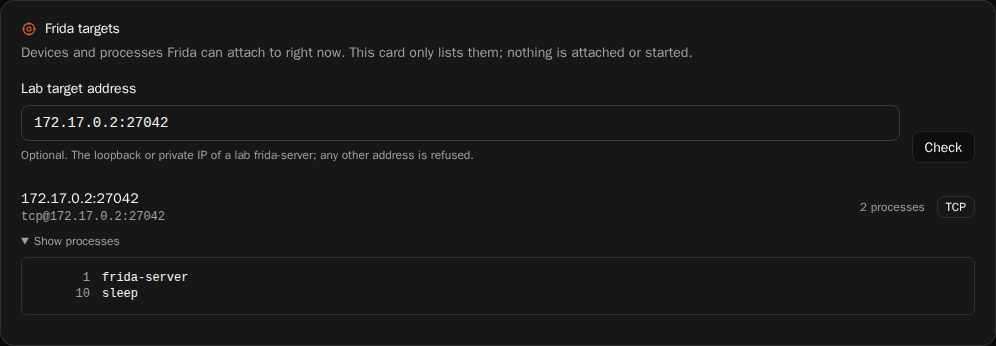

# PENT-09 — Frida Device & Process Inventory Tool

| | |
|---|---|
| Student | Ada Mert Kızılırmak (2520191019) · [@RedRiveRR](https://github.com/RedRiveRR) |
| Course | MYO062 — midterm |
| Task | PENT-09, reserved in [#124](https://github.com/keyvanarasteh/os-lab/pull/124) |
| Code | [`console/frida_inventory.py`](../../frida_inventory.py) · endpoint in [`android-lab/lab/web_ui.py`](../../../android-lab/lab/web_ui.py) · card in [`dashboard/src/views/frida-targets-card.tsx`](../../../dashboard/src/views/frida-targets-card.tsx) |
| Tests | [`test_frida_inventory.py`](../../../android-lab/lab/tests/test_frida_inventory.py) (53 tests) · [`test_web_ui.py`](../../../android-lab/lab/tests/test_web_ui.py) (2 tests) · [`health-and-content.spec.ts`](../../../dashboard/e2e/health-and-content.spec.ts) (1 browser test) |
| Verification | [`VERIFY.md`](VERIFY.md) |
| Proof video | [PENT-09-kanit-videosu-v2.mp4](https://drive.google.com/file/d/1s9lyTXlMTMKjIaj3FSG_uZ0PMz5xnqpr/view?usp=sharing) (3:43) |

## What it does

Before any Frida work the first question is "what can I attach to right now?".
Answering it normally takes two tools with two output formats: `frida-ls-devices`
for devices and `frida-ps` for processes, once per device.

`frida_inventory.py` answers it in one read-only command and prints a single
JSON document, so the console and agents can consume it without scraping tables:

- every attached device with its id, type, name, OS and transport (`local`, `USB` or `TCP`);
- the attachable processes (or, with `--apps`, applications) of each local and USB device;
- one named target instead, with `--usb`, `--device ID` or `--host IP[:PORT]`;
- which Frida tools were found, and every error that occurred, inside the same document.

```
python3 console/frida_inventory.py                      # everything attached
python3 console/frida_inventory.py -U --apps            # apps on the USB device / emulator
python3 console/frida_inventory.py -H 127.0.0.1         # a lab frida-server over TCP
python3 console/frida_inventory.py -f bank -o inv.json  # filter by name, also save to a file
```

Exit codes: `0` inventory complete, `1` a tool is missing or a listing failed
(the JSON is still printed and says what failed), `2` usage error or out-of-scope target.

## Output

One document, schema `oslab.frida-inventory/1`. Real output against the lab
target from [`VERIFY.md`](VERIFY.md) (`tools` block shortened):

```json
{
  "schema": "oslab.frida-inventory/1",
  "generatedAt": "2026-11-13T12:00:26Z",
  "readOnly": true,
  "backend": "api",
  "query": {"usb": false, "device": null, "host": "127.0.0.1:27042",
            "apps": false, "processes": true, "filter": null},
  "tools": {"frida-ls-devices": {"found": true, "path": "…"},
            "frida-ps": {"found": true, "path": "…"},
            "frida-python": {"found": true, "version": "17.24.3"}},
  "devices": [
    {
      "id": "tcp@127.0.0.1:27042",
      "type": "remote",
      "transport": "TCP",
      "name": "127.0.0.1:27042",
      "os": null,
      "processes": [
        {"pid": 1, "name": "frida-server"},
        {"pid": 10, "name": "sleep"}
      ],
      "processCount": 2,
      "error": null
    }
  ],
  "summary": {"devices": 1, "usb": 0, "tcp": 1, "processes": 2},
  "errors": []
}
```

With `--apps`, only running applications are listed and each entry also
carries the application `identifier` (for example `com.testlab.bank`).

## Dashboard card

The jobs view (`/jobs/`) has a **Frida targets** card that shows the same
inventory in the console:



- The web console serves the document at `GET /api/frida/inventory`. It calls
  `build_inventory()` directly, so the card and the command line cannot disagree.
- Each device is a row with its name, id, transport and process count; the
  process list opens on demand.
- An optional address field names one lab frida-server (`?host=`). It goes
  through the same scope guard: an address outside the lab is answered with
  400 and the reason is shown next to the field, before any Frida call.
- The card only lists. It has loading, empty and error states, its text is
  translated in all seven locale catalogs, and it is left out of the public
  Pages build, which has no local engine to ask.

## Design

**Two backends, one document.** The tool lists through the `frida` Python
module when it is importable (it is installed together with `frida-tools`) and
falls back to running `frida-ls-devices` and `frida-ps` otherwise;
`--backend api|cli` forces one. The module is preferred because the current
`frida-ls-devices` draws an interactive table: without a console it crashes
(`NoConsoleScreenBufferError` on Windows) and it can wait indefinitely on a
device that does not answer, which makes it unreliable to call from a server
or an agent. Both backends produce the same document.

**Read-only.** The tool only enumerates. It never attaches, spawns, injects,
kills or starts a frida-server. On the CLI path the only arguments ever passed
are `-D <id>`, `-H <host>`, `-j`, `-e` and `-a`; a test asserts this allowlist.

**Lab-only scope guard.** `--host` accepts only a literal loopback, private
(RFC 1918 / ULA) or link-local IP address, or `localhost`. Hostnames and public
addresses are refused with exit code 2 before any Frida code runs, so the tool
cannot be pointed at a target outside the lab even by mistake. Device ids are
checked against a strict pattern so a value can never be read as an option.

**Fails soft, never hangs.** A missing tool, a device that does not answer or a
frida-server that is not running becomes an entry in `errors` (and the device's
`error` field) instead of a traceback. Every listing has a timeout (`--timeout`,
default 20 s); a command that exceeds it is stopped together with its children.

**No new dependencies.** Standard library only; `frida` is imported lazily and
is optional. Logic lives in importable helpers (`build_inventory`,
`parse_lab_host`, …) behind a `main()`.

## Testing

`android-lab/lab/tests/test_frida_inventory.py` holds 53 offline tests. Frida is
replaced by fakes, so they need no device and no network. They cover output
parsing (JSON and table), the scope guard, the read-only argument allowlist,
target selection, filtering, error recording, both backends, timeouts and exit codes.

Two tests in `test_web_ui.py` cover the endpoint (the listing, a named target,
and the refusal of out-of-scope addresses with no Frida call). One Playwright
test drives the card in a browser against a mocked endpoint: first load, a
named target, the process list and a refused address.

Results of the real runs, including the full `./scripts/run-tests.sh` output on
Linux, are in [`VERIFY.md`](VERIFY.md).

## Limitations

- The dashboard card lists processes only; application listing (`--apps`) and
  the name filter are available on the command line.
- Live verification used a Linux lab container over TCP and the local device.
  The USB path (`-U`) is covered by tests with fakes only; no physical or
  emulated Android device was attached during verification.
- `os` is filled for local and USB devices only; a TCP target reports `null`.
