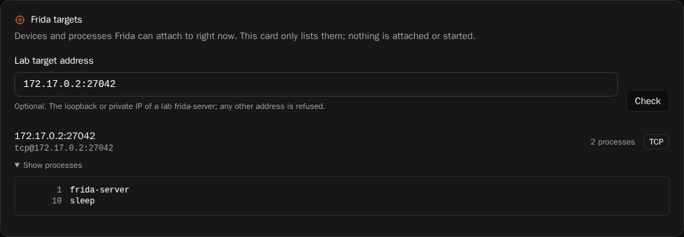
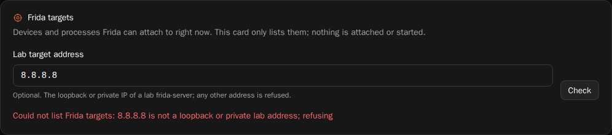

# PENT-09 — verification

Everything below was run on 2026-11-13. The only targets are the machine the
tool runs on and a throwaway container on the same machine, published on
loopback only. No target outside the lab was contacted.

Environment: Windows 11, Python 3.13, `frida` / `frida-tools` 17.24.3, Docker Desktop (WSL2).

## 1. Unit tests

```
$ cd android-lab/lab && python -m pytest tests/test_frida_inventory.py -q
.....................................................                    [100%]
53 passed in 2.61s

$ python -m pytest tests/test_web_ui.py -q -k frida
..                                                                       [100%]
2 passed, 16 deselected in 1.28s
```

## 2. Lab target

A disposable Linux container that runs the official `frida-server` 17.24.3.
The port is published on `127.0.0.1` only, so nothing outside the machine can reach it.

```
docker run -d --rm --name oslab-frida-target -p 127.0.0.1:27042:27042 python:3.13-slim sh -c '
  python -c "import lzma,urllib.request as u;open(\"/usr/local/bin/frida-server\",\"wb\").write(lzma.decompress(u.urlopen(\"https://github.com/frida/frida/releases/download/17.24.3/frida-server-17.24.3-linux-x86_64.xz\").read()))" &&
  chmod +x /usr/local/bin/frida-server && (sleep infinity &) && exec frida-server -l 0.0.0.0:27042'
```

Remove it afterwards with `docker rm -f oslab-frida-target`.

## 3. Inventory of the lab target (TCP)

```
$ python console/frida_inventory.py --host 127.0.0.1
  ...
  "backend": "api",
  "devices": [
    {
      "id": "tcp@127.0.0.1:27042",
      "type": "remote",
      "transport": "TCP",
      "name": "127.0.0.1:27042",
      "os": null,
      "processes": [
        {"pid": 1, "name": "frida-server"},
        {"pid": 10, "name": "sleep"}
      ],
      "processCount": 2,
      "error": null
    }
  ],
  "summary": {"devices": 1, "usb": 0, "tcp": 1, "processes": 2},
  "errors": []
exit code 0
```

The two processes are exactly the ones in the container (`docker top oslab-frida-target`).
The command-line backend returns the same result:

```
$ python console/frida_inventory.py --host 127.0.0.1 --backend cli --compact
... "backend": "cli", ... "summary": {"devices": 1, "usb": 0, "tcp": 1, "processes": 2}, "errors": []}
exit code 0
```

Filter:

```
$ python console/frida_inventory.py --host 127.0.0.1 -f sleep --compact
... "processes": [{"pid": 10, "name": "sleep"}], "processCount": 1 ...
```

## 4. Device listing

```
$ python console/frida_inventory.py --no-processes
  "devices": [
    {"id": "local",    "type": "local",  "transport": "local", "name": "Local System",    "os": "Windows 10.0.26300", ...},
    {"id": "socket",   "type": "remote", "transport": "TCP",   "name": "Local Socket",    "os": null, ...},
    {"id": "barebone", "type": "remote", "transport": "TCP",   "name": "GDB Remote Stub", "os": null, ...}
  ],
  "summary": {"devices": 3, "usb": 0, "tcp": 2, "processes": 0},
  "errors": []
exit code 0
```

(Rows condensed to one line each. `socket` and `barebone` are Frida's built-in remote entries.)

## 5. Scope guard

```
$ python console/frida_inventory.py --host 8.8.8.8
error: 8.8.8.8 is not a loopback or private lab address; refusing
exit code 2

$ python console/frida_inventory.py --host example.com
error: 'example.com' is not an IP address; use the lab device's loopback or private IP
exit code 2
```

Nothing is printed on stdout and no Frida call is made in either case.

## 6. Failures are reported, not raised

With the lab container stopped:

```
$ python console/frida_inventory.py --host 127.0.0.1 -t 5
  "devices": [{"id": "tcp@127.0.0.1:27042", ..., "processes": null,
               "error": "process listing failed: unable to connect to remote frida-server"}],
  "errors": [{"stage": "processes", "device": "tcp@127.0.0.1:27042",
              "message": "process listing failed: unable to connect to remote frida-server"}]
exit code 1

$ python console/frida_inventory.py -U -t 5
  "devices": [],
  "errors": [{"stage": "devices", "message": "no USB device attached"}]
exit code 1
```

## 7. Dashboard card

The web console serves the inventory at `GET /api/frida/inventory`. Against the
lab target from section 2, with the console running on the same machine:

```
GET /api/frida/inventory?host=127.0.0.1      -> 200
  "backend": "api",
  "devices": [{"id": "tcp@127.0.0.1:27042", "type": "remote", "transport": "TCP", "name": "127.0.0.1:27042",
               "processes": [{"pid": 1, "name": "frida-server"}, {"pid": 10, "name": "sleep"}], "processCount": 2, "error": null}],
  "summary": {"devices": 1, "usb": 0, "tcp": 1, "processes": 2}, "errors": []

GET /api/frida/inventory?host=8.8.8.8        -> 400
  {"error": "8.8.8.8 is not a loopback or private lab address; refusing"}

GET /api/frida/inventory?host=example.com    -> 400
  {"error": "'example.com' is not an IP address; use the lab device's loopback or private IP"}
```

The card on `/jobs/`, served by the web console from the committed
`dashboard/dist`. Here the console ran in a second container, so the lab
target is reached on its private Docker bridge address instead of loopback:



An address outside the lab is refused and the reason is shown in the card:



Dashboard checks, run in `dashboard/` on Linux with Node 22
(`mcr.microsoft.com/playwright:v1.65.0-noble` container):

```
$ npm run check
> tsc --noEmit
(no errors)

$ npm run test:i18n
2330 keys match across 7 locales; no new untranslated TSX strings.

$ npm run build
(ok; the committed dashboard/dist is this build, byte for byte)

$ npm run test:e2e
  1 skipped
  54 passed (30.9s)
```

The skipped browser test is an existing one; the new test is
`jobs view lists the Frida targets and shows a refused address`.

## 8. Full test runner

`./scripts/run-tests.sh` on Linux (`python:3.13` container, normal user, fresh
clone of this branch on top of `master` at `90f571f6`, `lat` installed):

```
== Stage 1: android unit tests (pytest) ==
FAILED tests/test_web_ui.py::test_lab_start_requires_a_previewed_plan - assert 400 == 409
1 failed, 223 passed, 2 skipped in 41.73s
[fail] android-lab/lab test suite
== Source Lab engine tests (pytest) ==
176 passed in 11.00s
[ok]   source-lab/engine test suite
== Cleanup Lab reference tests (unittest) ==
[ok]   cleanup-lab/reference/python
== Cleanup Lab engine tests (unittest) ==
FAIL: test_refusal_codes_are_stable (test_safety.TargetTest.test_refusal_codes_are_stable) (path='/tmp/tmpvp9t91hr/caches/app', code='app-running')
FAILED (failures=1)
[fail] cleanup-lab/engine
== Cleanup Lab qrust-scan crate (cargo test) ==
[skip] cargo not installed; qrust-scan tests not run
== Stage 2: android sample analysis pipeline (smoke) ==
[ok]   sample analysis + report generated in android-lab/lab/artifacts/security-scan
== Stage 3: shell script syntax (bash -n) ==
[ok]   all 71 shell scripts parse
== Stage 4: lat.md knowledge graph ==
[ok]   lat check
== Stage 5: dashboard (typecheck + committed build is current) ==
[skip] dashboard dependencies not installed (cd dashboard && npm ci) — skipping
== Summary ==
5 passed, 2 failed, 2 skipped
```

The runner is **not** fully green. The two failing tests are not caused by this
change; both also fail on unmodified `master` (`90f571f6`) in the same image:

```
$ git checkout 90f571f6
$ (cd android-lab/lab && python -m pytest tests/test_web_ui.py -q)
FAILED tests/test_web_ui.py::test_lab_start_requires_a_previewed_plan - assert 400 == 409
1 failed, 15 passed
$ (cd cleanup-lab/engine && python -m unittest discover -s tests -p 'test_*.py' -q)
FAIL: test_refusal_codes_are_stable (tests.test_safety.TargetTest.test_refusal_codes_are_stable)
```

Both depend on the host. The first asks for the Android Lab `status` action,
which this container does not offer (`Unsupported action for Android Lab:
status`), so the request is rejected with 400 before the token check. The
second expects a running-application check to refuse a path. This PR changes
neither test nor the code they exercise.

Stage 5 is skipped because the runner only runs it when `dashboard/node_modules`
exists; the dashboard checks are in section 7. When it does run, its
"dist matches the sources" comparison also fails on unmodified `master` in this
environment: a rebuild differs from the committed build in 505 HTML pages and
in no script or style file. In the page inspected (`404.html`) the only
difference is the generated `astro-island uid` attribute.

All tests added by this PR pass (53 + 2 Python, 1 browser), and `lat check` passes.
