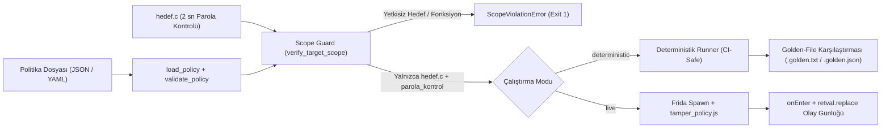

# PENT-07 · Interceptor `retval.replace` ve Argument-Tampering Kütüphanesi

| Alan | Değer |
|---|---|
| **Öğrenci** | Baha Furkan Yıldız (`bfurkanyildiz`) |
| **Ders** | MYO062 — Vize Projesi (Seçenek 7) |
| **Görev** | [PENT-07](../../../CONTRIBUTING.md) · Interceptor `retval.replace` & Argument-Tampering Script Library |
| **Rezervasyon** | [`reservations/PENT-07.json`](../../../reservations/PENT-07.json) |
| **Kanıt Videosu** | **[KANIT_VIDEO_LINKI]** |

---

## 1. Görev Özeti ve Teknik Mimari

**PENT-07**, 05.10 dersinde işlenen `hedef.c` (2 saniyelik parola doğrulama döngüsü), `gozlem.js` ve `degistir.js` (`Interceptor.attach`, `onEnter`, `onLeave`, `retval.replace`) pratiklerini dışarıdan verilen bir **JSON/YAML politika dosyası** ile yönetilebilir, kapsam kilidi (*Scope Guard*) korumalı ve **golden-file testli** bir kanca kütüphanesine dönüştürür.

Çözüm hem gerçek Frida çalışma zamanında (`frida` + derlenmiş `hedef` ikilisi) hem de derleyici veya Frida arka plan servisi bulunmayan *headless* CI ortamlarında deterministik doğrulama yapabilecek çift modlu bir mimariyle tasarlanmıştır.



### Bileşen Envanteri

| Dosya | Sorumluluk |
|---|---|
| [`android-lab/lab/tests/targets/hedef.c`](../../../android-lab/lab/tests/targets/hedef.c) | İzole, çapraz platform (Windows/Linux) C99 kimlik doğrulama hedefi. `parola_kontrol(const char *girilen_parola, int yetki_seviyesi)` fonksiyonunu varsayılan 2000 ms aralıkla 3 kez çağırır (`EXPECTED_PASS = "gizli123"`, `MIN_REQUIRED_LEVEL = 1`). |
| [`android-lab/lab/hooks/tamper_policy.js`](../../../android-lab/lab/hooks/tamper_policy.js) | Politika tabanlı Frida kanca kütüphanesi. `onEnter` aşamasında `readArg` / `tamperArg` (`Memory.allocUtf8String` + GC sabitlemesi), `onLeave` aşamasında `tamperRetval` (`retval.replace`) işlemlerini uygular ve `rpc.exports` üzerinden dinamik politika yükler. |
| [`android-lab/lab/scripts/tamper_runner.py`](../../../android-lab/lab/scripts/tamper_runner.py) | Yalnızca Python standart kütüphanesi kullanan politika doğrulayıcı, *Scope Guard*, deterministik yürütücü, isteğe bağlı canlı Frida başlatıcı (`--mode live`) ve golden-file doğrulayıcı (`--verify-golden`). |
| [`android-lab/lab/tests/fixtures/pent07/policies/`](../../../android-lab/lab/tests/fixtures/pent07/policies/) | 5 farklı senaryo politikası (`01_baseline_unhooked` … `05_combined_policy`). |
| [`android-lab/lab/tests/fixtures/pent07/golden/`](../../../android-lab/lab/tests/fixtures/pent07/golden/) | Her politika için deterministik referans metin (`.golden.txt`) ve JSON (`.golden.json`) çıktıları. |
| [`android-lab/lab/tests/test_tamper_runner.py`](../../../android-lab/lab/tests/test_tamper_runner.py) | 33 adet pytest birim, golden-file, YAML ayrıştırma, kapsam kilidi ve sözleşme testi. |
| [`scripts/run-tests.sh`](../../../scripts/run-tests.sh) | Stage 1 içine `tamper_runner.py --verify-golden` doğrulaması ve Windows/Linux `.venv-test` uyumluluğu entegre edilmiştir. |
| [`lat.md/android-lab.md`](../../../lat.md/android-lab.md) | Bilgi grafiğine *Policy-driven Interceptor runner* bölümü eklenmiştir. |

### Kapsam Kilidi (*Scope Guard*) Tasarımı

Hem Python çalıştırıcısında (`verify_target_scope`) hem de Frida kancası içinde (`assertPolicyScope`) fail-closed kapsam kilidi uygulanır:
1. Yalnızca repodaki yetkili [`android-lab/lab/tests/targets/hedef.c`](../../../android-lab/lab/tests/targets/hedef.c) hedefi ve `parola_kontrol` / `check_password` fonksiyonları kabul edilir.
2. Başında/sonunda boşluk, kontrol karakteri, URL (`https://`, `file://`), ham PID (`12345`), paket adı (`com.example.*`), dizin atlama (`../../`), symlink / NTFS reparse noktası ve sahte kopyalar (`tmp_path/hedef.c`) kesin olarak reddedilir (çıkış kodu `1`).
3. `system`, `execve` gibi yetkisiz fonksiyonlara kanca atmaya çalışan politikalar çalıştırılmadan durdurulur.

---

## 2. Kurulum ve Çalıştırma Komutları

Depo kök dizininden ek üçüncü parti paket kurmadan doğrudan Python 3.11+ ile çalıştırılabilir:

```bash
# 1. Kapsam Kilidi (Scope Guard) kontrolü
python android-lab/lab/scripts/tamper_runner.py --check-scope android-lab/lab/tests/targets/hedef.c
python android-lab/lab/scripts/tamper_runner.py --check-scope /bin/ls

# 2. Tek bir politika senaryosunu çalıştırma
python android-lab/lab/scripts/tamper_runner.py \
  --policy android-lab/lab/tests/fixtures/pent07/policies/01_baseline_unhooked.json

python android-lab/lab/scripts/tamper_runner.py \
  --policy android-lab/lab/tests/fixtures/pent07/policies/03_onenter_arg_tamper.json

python android-lab/lab/scripts/tamper_runner.py \
  --policy android-lab/lab/tests/fixtures/pent07/policies/04_onleave_retval_replace.json

python android-lab/lab/scripts/tamper_runner.py \
  --policy android-lab/lab/tests/fixtures/pent07/policies/05_combined_policy.json

# 3. Golden-File test paketinin tamamını doğrulama
python android-lab/lab/scripts/tamper_runner.py --verify-golden

# 4. Pytest ve tam CI eşdeğeri test koşumu
python -m pytest android-lab/lab/tests/test_tamper_runner.py -v
./scripts/run-tests.sh
```

> [!NOTE]
> Yerel makinede `gcc`/`clang` ve `frida` kuruluysa `--mode live` parametresi ile `hedef.c` geçici bir dizinde derlenip `tamper_policy.js` canlı süreç içine enjekte edilebilir; geçici ikili dosya çalışma sonunda otomatik olarak silinir ve repoda derleme artığı bırakılmaz.

---

## 3. Politika Senaryoları ve Doğrulama Çıktıları

| Senaryo | Politika Dosyası | `onEnter` Müdahalesi | `onLeave` (`retval.replace`) | Yerel Dönüş | Son Durum |
|---|---|---|---|---|---|
| 1. Kancasız Temel Çalışma | `01_baseline_unhooked.json` | Yok | Yok | `0` | `REDDEDILDI` |
| 2. Salt Gözlem (`gozlem.js`) | `02_observe_gozlem.json` | `arg[0]`, `arg[1]` okur | `retval` okur | `0` | `REDDEDILDI` |
| 3. `onEnter` Argüman Değiştirme | `03_onenter_arg_tamper.json` | `"deneme123"` → `"gizli123"` | Kapalı | `1` | `ONAYLANDI` |
| 4. `retval.replace` (`degistir.js`) | `04_onleave_retval_replace.json` | Yok (gözlem açık) | `0` → `1` | `0` | `ONAYLANDI` |
| 5. Birleşik Politika | `05_combined_policy.json` | `yetki_seviyesi` `0` → `5` | `0` → `1` | `0` | `ONAYLANDI` |

### Gerçek Terminal Doğrulama Çıktıları

#### A) Kancasız Temel Çalışma (`01_baseline_unhooked`)

```text
[PENT-07] policy=01_baseline_unhooked | target=android-lab/lab/tests/targets/hedef.c | fn=parola_kontrol | scope=VERIFIED
[PENT-07] schedule=3x2000ms | inputs=parola:"deneme123",yetki_seviyesi:1 | hook_active=false
[t=0ms] [HEDEF] native parola_kontrol("deneme123", 1) -> 0
[t=0ms] [HEDEF] iter=1/3 | girilen="deneme123" | seviye=1 | sonuc=0 | durum=REDDEDILDI
[t=2000ms] [HEDEF] native parola_kontrol("deneme123", 1) -> 0
[t=2000ms] [HEDEF] iter=2/3 | girilen="deneme123" | seviye=1 | sonuc=0 | durum=REDDEDILDI
[t=4000ms] [HEDEF] native parola_kontrol("deneme123", 1) -> 0
[t=4000ms] [HEDEF] iter=3/3 | girilen="deneme123" | seviye=1 | sonuc=0 | durum=REDDEDILDI
[SUMMARY] calls=3 | approved=0 | rejected=3 | arg_tampers=0 | retval_replacements=0 | final=REDDEDILDI
```

#### B) `onEnter` Argüman Manipülasyonu (`03_onenter_arg_tamper`)

```text
[PENT-07] policy=03_onenter_arg_tamper | target=android-lab/lab/tests/targets/hedef.c | fn=parola_kontrol | scope=VERIFIED
[PENT-07] schedule=3x2000ms | inputs=parola:"deneme123",yetki_seviyesi:1 | hook_active=true
[t=0ms] [INTERCEPTOR] onEnter parola_kontrol | observed={"girilen_parola": "deneme123", "yetki_seviyesi": 1} | tampered=[{"after": "gizli123", "before": "deneme123", "index": 0, "name": "girilen_parola", "type": "utf8"}]
[t=0ms] [HEDEF] native parola_kontrol("gizli123", 1) -> 1
[t=0ms] [INTERCEPTOR] onLeave parola_kontrol | observed_retval=1 | final_retval=1 | retval_replaced=false
[t=0ms] [HEDEF] iter=1/3 | girilen="deneme123" | seviye=1 | sonuc=1 | durum=ONAYLANDI
...
[SUMMARY] calls=3 | approved=3 | rejected=0 | arg_tampers=3 | retval_replacements=0 | final=ONAYLANDI
```

#### C) `onLeave` / `retval.replace` Dönüş Değeri Manipülasyonu (`04_onleave_retval_replace`)

```text
[PENT-07] policy=04_onleave_retval_replace | target=android-lab/lab/tests/targets/hedef.c | fn=parola_kontrol | scope=VERIFIED
[PENT-07] schedule=3x2000ms | inputs=parola:"deneme123",yetki_seviyesi:1 | hook_active=true
[t=0ms] [INTERCEPTOR] onEnter parola_kontrol | observed={"girilen_parola": "deneme123", "yetki_seviyesi": 1} | tampered=[]
[t=0ms] [HEDEF] native parola_kontrol("deneme123", 1) -> 0
[t=0ms] [INTERCEPTOR] onLeave parola_kontrol | observed_retval=0 | final_retval=1 | retval_replaced=true
[t=0ms] [HEDEF] iter=1/3 | girilen="deneme123" | seviye=1 | sonuc=1 | durum=ONAYLANDI
...
[SUMMARY] calls=3 | approved=3 | rejected=0 | arg_tampers=0 | retval_replacements=3 | final=ONAYLANDI
```

#### D) Birleşik `onEnter` + `onLeave` Politikası (`05_combined_policy`)

```text
[PENT-07] policy=05_combined_policy | target=android-lab/lab/tests/targets/hedef.c | fn=parola_kontrol | scope=VERIFIED
[PENT-07] schedule=3x2000ms | inputs=parola:"yanlis_parola",yetki_seviyesi:0 | hook_active=true
[t=0ms] [INTERCEPTOR] onEnter parola_kontrol | observed={"girilen_parola": "yanlis_parola", "yetki_seviyesi": 0} | tampered=[{"after": 5, "before": 0, "index": 1, "name": "yetki_seviyesi", "type": "int32"}]
[t=0ms] [HEDEF] native parola_kontrol("yanlis_parola", 5) -> 0
[t=0ms] [INTERCEPTOR] onLeave parola_kontrol | observed_retval=0 | final_retval=1 | retval_replaced=true
[t=0ms] [HEDEF] iter=1/3 | girilen="yanlis_parola" | seviye=0 | sonuc=1 | durum=ONAYLANDI
...
[SUMMARY] calls=3 | approved=3 | rejected=0 | arg_tampers=3 | retval_replacements=3 | final=ONAYLANDI
```

#### E) Kapsam Kilidi (*Scope Guard*) Kontrolleri

```text
$ python android-lab/lab/scripts/tamper_runner.py --check-scope android-lab/lab/tests/targets/hedef.c
[ALLOW] C:\Users\Furka\os-lab\android-lab\lab\tests\targets\hedef.c

$ python android-lab/lab/scripts/tamper_runner.py --check-scope /bin/ls
[DENY] Scope violation: target does not exist: /bin/ls

$ python android-lab/lab/scripts/tamper_runner.py --check-scope "C:\Windows\System32\cmd.exe"
[DENY] Scope violation: target escapes authorized targets directory: C:\Windows\System32\cmd.exe
```

---

## 4. `./scripts/run-tests.sh` ve Test Sonuç Özeti

Tüm değişikliklerden sonra çalıştırılan doğrulama paketlerinin sonuçları aşağıdadır:

| Kontrol | Komut | Sonuç |
|---|---|---|
| PENT-07 Birim & Golden-File Testleri | `python -m pytest android-lab/lab/tests/test_tamper_runner.py -v` | **33 passed**, 0 failed, 0 skipped (0.17s) |
| Golden-File CLI Doğrulaması | `python android-lab/lab/scripts/tamper_runner.py --verify-golden` | **5/5 `[OK]`**, exit code `0` |
| İçerik Paketi Doğrulaması | `python scripts/verify-content.py` | **all checks passed** (`tamper_policy.js` → `hooks`, SHA-256 doğrulandı) |
| Tam Test Runner (`./scripts/run-tests.sh`) | `bash ./scripts/run-tests.sh` | **4 passed, 0 failed, 2 skipped** (`All required checks passed.`, exit code `0`) |

`./scripts/run-tests.sh` aşama detayları:
- **Stage 1 (`android-lab/lab` pytest):** `129 passed, 2 skipped in 7.96s` (`JADX` kurulu olmadığı için 1 JADX testi ve macOS'a özel `appium.sh` testi atlandı; `tamper_runner` ve diğer tüm birim testleri geçti).
- **PENT-07 Golden-File Verification:** 5/5 politika referans çıktısıyla birebir eşleşti (`[ok]`).
- **Stage 2 (Sample Analysis Pipeline):** APK üretimi, analiz ve HTML/MD/JSON raporlama başarılı (`[ok]`).
- **Stage 3 (`bash -n`):** Repo genelindeki 63 `.sh` betiğinin tamamı sözdizimi denetimini geçti (`[ok]`).
- **Stage 4 & 5:** `lat` ve `dashboard/node_modules` kurulu olmadığı için bilgi verilerek atlandı (`[skip]`).

---

## 5. Kanıt Videosu
>
> **Kanıt Videosu Bağlantısı:** https://www.youtube.com/watch?v=CPrrVqzbc3A
