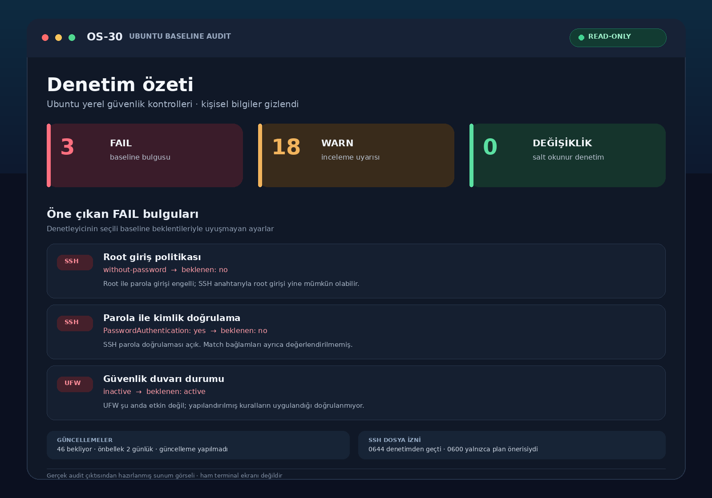

# linux-lab: the runnable Linux VM lab

A minimal, reproducible **Linux virtual machine** on an Ubuntu Server host,
built on [`qemux/qemu`](https://github.com/qemus/qemu). One compose stack, one
set of scripts, and a Makefile that covers setup, boot, status, backup and
recovery — the Linux sibling of [`win-lab`](../win-lab/) and the Ubuntu path of
[`ios-lab`](../ios-lab/).

Use it as an isolated, disposable Linux guest: malware detonation and dynamic
analysis of ELF binaries, kernel/exploit experiments, container-escape practice,
or any work you want kept away from the host — all behind KVM, reachable over a
web viewer or SSH, and resettable in one command.

```
┌──────────────────── linux-lab (docker compose) ──────────────────┐
│ linux (qemux/qemu)                                               │
│   QEMU + KVM · UEFI boot (BOOT_MODE)                             │
│   noVNC web viewer  :8006                                        │
│   SSH               :2222 -> guest :22                           │
│   /storage  -> ./storage   (disk image, ISO cache, linux.ready)  │
│   /shared   -> ./shared    (host <-> guest files, where exposed) │
└───────────────────────────────────────────────────────────────────┘
        devices: /dev/kvm, /dev/net/tun   cap: NET_ADMIN
```

> ⚠️ **Isolation only.** Treat the guest as untrusted. Do not expose the web
> viewer or SSH to untrusted networks, and do not bridge a detonation guest to
> a network you care about. See [`knowledge/networking.md`](knowledge/networking.md).

## Requirements

- Ubuntu Server (22.04/24.04/26.04) or another Linux with KVM.
- `/dev/kvm` accessible to your user (member of the `kvm` group).
- Docker Engine with Compose (or Podman with a Compose provider).
- 16 GB free disk minimum, 32 GB+ recommended; 2 GB free RAM minimum.
- Outbound HTTPS on first boot, unless you provide a local ISO.

Run `make preflight` to check all of it.

## Quick start

```bash
cd linux-lab
cp .env.example .env
$EDITOR .env                  # pick BOOT (distro) and change LINUX_PASSWORD
sudo ./setup.sh               # KVM + Docker + groups + directories
newgrp docker                 # or log out/in
make preflight
make boot                     # start; open http://<server-ip>:8006/
make wait-ready               # wait for the web viewer + SSH
make status
```

`BOOT` accepts a distro shortcut (`ubuntu`, `debian`, `alpine`, `fedora`,
`arch`, `kali`, ...) or an ISO URL; a local `./boot.iso` bound into the
container overrides it. The first boot downloads media and provisions the guest.

Connect over SSH (`make ssh` prints the details) or use the web viewer.

## Make targets

| Target | What it does |
|---|---|
| `preflight` | OS / KVM / runtime / ports / disk / RAM checks |
| `setup` | install KVM and Docker, add user to `kvm`/`docker`, create dirs |
| `prepare` | create `.env` and `storage/ shared/ backups/` |
| `up` / `boot` | start; `boot` also waits for the web viewer |
| `wait` / `wait-ready` | wait for the web viewer; `wait-ready` also waits for SSH |
| `status` | compose state, web port, SSH port, boot marker, storage size |
| `monitor` / `profiles` | live dashboard; list management profiles |
| `logs` / `shell` | follow logs; shell inside the container |
| `ssh` / `share` | print SSH connection details; show the shared folder |
| `restart` / `update` | graceful restart; pull image and recreate |
| `backup` / `restore` | cold backup and restore (`FULL=1` adds shared) |
| `install-service` | systemd unit so the VM starts at boot |
| `down` | graceful stop |
| `reset` | destroy disks and re-provision on next boot (`CONFIRM=yes`) |
| `clean` | remove `backups/` only |

Examples:

```bash
make boot
make backup FULL=1
make restore FILE=backups/linux-lab-20260101-120000.tar.gz
make logs
make reset CONFIRM=yes
```

## Profiles and management

The repo-level `labctl` adds presets, hardware changes and a live dashboard:

```bash
../labctl linux profiles
../labctl linux profile use lightweight   # 2 CPU / 2 GB / 16 GB disk
../labctl linux start --wait
../labctl linux monitor
../labctl linux resize --cpus 4 --ram 8G --apply
../labctl linux config show
../labctl linux stop
```

| Profile | CPU | RAM | Disk | Notes |
|---|---:|---:|---:|---|
| `lightweight` | 2 | 2G | 16G | triage and static work on a small host |
| `development` | 4 | 4G | 32G | balanced interactive analysis, debug logging on |
| `performance` | 6 | 8G | 64G | builds, fuzzing and heavier workloads |

`profile use` writes the preset into `.env`; `--profile P` is a one-shot
overlay. The disk is persistent and grow-only: `resize --disk 128G` expands the
virtual disk, then grow the partition/filesystem inside the guest. Hardware
changes require `--apply` (or `restart`) to recreate the container.

## Layout

```
linux-lab/
├── docker-compose.yml      # qemux/qemu service
├── .env.example            # image, distro, resources, ports, credentials
├── profiles/               # lightweight / development / performance presets
├── Makefile                # all targets above
├── scripts/
│   ├── preflight.sh        # read-only host checks
│   ├── setup-ubuntu.sh     # KVM + Docker + groups + dirs (+ optional ufw)
│   ├── wait-ready.sh       # web viewer and SSH readiness
│   ├── backup.sh           # cold archive of storage + config
│   ├── restore.sh          # restore an archive
│   ├── install-service.sh  # systemd unit generator
│   ├── uninstall-service.sh
│   └── bonus/              # read-only diagnostics: env-doctor, port-check, ssh-config-doctor (see bonus/README.md)
├── storage/                # VM disk, ISO cache, linux.ready (gitignored)
├── shared/                 # host <-> guest files (gitignored)
└── backups/                # archives (gitignored)
```

## Readiness model

- Container `Up`: QEMU started. Not enough to use the guest.
- Web viewer HTTP 200: the viewer is serving; boot may still be in progress.
- SSH accepting on `SSH_PORT`: the guest is up and reachable.
  `make wait-ready` waits for this and writes `storage/linux.ready`.

## Customisation

Everything is environment-driven; edit `.env` and `make restart`:

- `BOOT` (`ubuntu`, `debian`, `alpine`, `fedora`, `arch`, `kali`, an ISO URL, ...)
- `BOOT_MODE` (`uefi`, `legacy`, `windows`, `windows_legacy`)
- `RAM_SIZE`, `CPU_CORES`, `DISK_SIZE`, `DISK_FMT`
- `LINUX_USER`, `LINUX_PASSWORD`
- `WEB_PORT`, `SSH_PORT`

For a local ISO, bind `./boot.iso:/boot.iso` in compose. See
[`knowledge/setup.md`](knowledge/setup.md) for host setup and
[`knowledge/operations.md`](knowledge/operations.md) for day-to-day use.

## Agent brief (compact)

- **Mission:** provide a reproducible, isolated Linux guest on an Ubuntu Server
  host, reachable over the web viewer or SSH, driven by `make`.
- **Tools:** `docker compose`, `curl` (readiness), `/dev/tcp` (SSH probe),
  `tar` (backup), `ufw` (optional), `ssh` (client side).
- **State:** all guest state is in `storage/`; configuration is `.env` plus
  `docker-compose.yml`. There is no other state.
- **Guardrails:** never expose the web viewer or SSH publicly; do not bridge a
  detonation guest to a trusted network; `make reset` is destructive.
- **Return shape:** a running container named `linux-lab`, a web viewer on
  `WEB_PORT`, SSH on `SSH_PORT`, and `storage/linux.ready` once SSH is up.

See [`knowledge/`](knowledge/) for research, setup, operations, networking and
use cases.

## Ubuntu baseline hardening (OS-30)

Inside the authorized Ubuntu guest (including UTM ARM64), run from the repository root:

```bash
python3 linux-lab/scripts/harden_check.py audit
python3 linux-lab/scripts/harden_check.py audit --format json
python3 linux-lab/scripts/harden_check.py plan --fix ssh-permissions
```

The default audit is read-only and reports SSH, users/sudo, cached updates and UFW.
It requires the companion `linux-lab/scripts/hardening.sh`; missing or empty
collector code is an execution error, never a clean audit.
An administrator can preview selected permission, timer or management-rule repairs
with `plan`; `apply` requires root, TTYs and exact `APPLY OS-30` consent. It never
installs pending upgrades, disables SSH authentication or automatically enables UFW.
The existing `hardening.sh` remains an audit-only entry point. See
[hardening guidance](knowledge/hardening.md) for preconditions, backup/recovery,
coverage limits and isolated tests; `VERIFY.md` records actual verification.

Completed schema-2 repair runs can be reverted with
`sudo python3 linux-lab/scripts/harden_check.py rollback <run-id>` inside the
authorized guest. It previews the changes and requires exact
`ROLLBACK OS-30 <run-id>` consent. Modified targets and legacy/incomplete backups
are refused; UFW deletion requires unique run-rule and exact state evidence.
See the [rollback safety and recovery instructions](knowledge/hardening.md#explicit-rollback-of-a-completed-run).
Rollback has only mock/temporary-file verification, not live UTM verification.

Run focused offline tests with
`python3 -m unittest discover -s linux-lab/tests -v`; executed results are in
`VERIFY.md`. Permission changes such as 0644 -> 0600 are an optional stricter
profile: an existing root-owned 0644 config can already pass audit.
Share only synthetic fixtures or sanitized summaries, not raw server audit output.

Current focused verification: **114 tests passed** using fake system commands
and temporary files (uncommitted fixes on `bdcc521`, Ubuntu 24.04.3 on WSL2,
Python 3.12.3); see `VERIFY.md` for commands and evidence limits.

### Salt okunur audit özeti



Bu görsel, paylaşılan Ubuntu audit sonucunun kişisel bilgileri gizlenmiş sunum
özetidir; ham terminal çıktısı veya yeniden çalıştırılmış bir test değildir.
Görselde **3 FAIL, 18 WARN ve 0 değişiklik** raporlanır. Üç FAIL, seçili baseline'a
uymayan SSH root giriş politikası, açık parola doğrulaması ve pasif UFW durumudur.
WARN sayısı inceleme gerektiren veya kesin doğrulanamayan kontrolleri belirtir;
her uyarı kanıtlanmış bir güvenlik açığı anlamına gelmez.

Görseldeki 46 bekleyen güncelleme ve iki günlük paket önbelleği, bu özete ait
ölçümlerdir; güncel sistem durumu olarak kabul edilmemelidir. Audit paket listesi
yenilemez, güncelleme kurmaz ve ayar değiştirmez. Root sahipliğindeki 0644 SSH
yapılandırma izni denetimden geçebilir; 0600 önerisi isteğe bağlı daha sıkı bir
izin profilidir, mevcut bir FAIL değildir.

Bu görsel önceki audit çalıştırmalarıyla birleştirilmemelidir; sürüm ve çalışma
bağlamına göre toplamlar değişebilir. Görsel tek başına JSON çıktısının, canlı
`apply` veya canlı `rollback` işlemlerinin doğrulandığını göstermez. Mock test
sonuçları ve doğrulama sınırları için [VERIFY.md](../VERIFY.md) dosyasına bakın.
